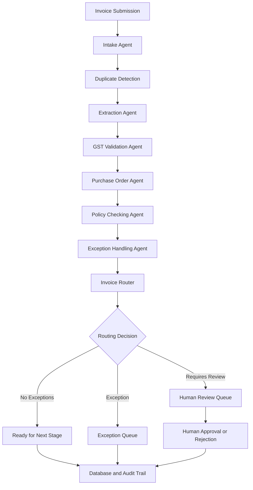

# Nimbus Retail – Multi-Agent Invoice Processing System

## 1. Project Overview

The Nimbus Retail Multi-Agent Invoice Processing System is an AI-inspired, agent-based invoice processing application designed to automate and streamline the accounts payable workflow.

The system uses multiple specialized Python agents to process invoice information, validate business rules, identify exceptions, and route invoices for further processing or human review.

It is built using FastAPI, Python, SQLAlchemy, SQLite, and Pydantic.

**Important:** This project demonstrates invoice workflow automation. It does not autonomously initiate payments.

## 2. Problem Statement

Manual invoice processing can be time-consuming and prone to errors, including:

- Duplicate invoice submissions.
- Incorrect or invalid GST information.
- Missing or mismatched purchase orders.
- Incorrect invoice calculations.
- Policy violations.
- Insufficient invoice data.

The system addresses these challenges through specialized agents, validation checks, database persistence, exception handling, and human approval.

## 3. Project Objectives

- Automate invoice intake and structured-data processing.
- Validate invoice details and calculations.
- Detect duplicate invoices.
- Perform mock GST validation.
- Verify purchase order information.
- Apply invoice approval policies.
- Identify exceptions and route invoices for human review.
- Maintain a database-backed audit trail.
- Store uploaded invoice documents.
- Provide REST APIs for invoice management.

## 4. Technology Stack

| Technology | Purpose |
|---|---|
| Python 3.14 | Core programming language |
| FastAPI | REST API development |
| Pydantic | Data validation |
| SQLAlchemy | Database ORM |
| SQLite | Persistent data storage |
| Uvicorn | ASGI server |
| Pytest | Automated testing |
| HTTPX | API testing dependencies |

## 5. Multi-Agent Architecture

The application uses a lightweight custom Python orchestration approach.

### Specialized Agents

1. **Invoice Intake Agent:** Receives invoice information and initializes the processing packet.
2. **Invoice Extraction Agent:** Checks structured invoice data, calculation consistency, and extraction confidence.
3. **GST Validation Agent:** Validates GSTIN format and checks a mock vendor registry.
4. **Purchase Order Validation Agent:** Checks purchase order availability and matching vendor and amount information.
5. **Policy Checking Agent:** Applies business rules, including the ₹50,000 human-approval threshold.
6. **Duplicate Detection:** Checks existing invoices using GSTIN and invoice number.
7. **Exception Handling Agent:** Identifies issues and marks invoices requiring human review.
8. **Invoice Router Agent:** Determines the appropriate processing destination.
9. **Audit Service:** Records invoice status transitions and retrieves audit history.

### Workflow



## 6. Business Rules

| Condition | System Action |
|---|---|
| Invoice amount above ₹50,000 | Human review required |
| Unknown or invalid GST information | Human review required |
| Missing or mismatched purchase order | Exception and human review |
| Extraction confidence below 0.80 | Human review required |
| Duplicate invoice | Human review required |
| Database or processing failure | Fail-safe handling and human review |

Human approval does not initiate a payment.

## 7. Invoice Statuses

- `received`
- `extracted`
- `under_review`
- `exception`
- `approved`
- `rejected`

## 8. API Endpoints

| Method | Endpoint | Description |
|---|---|---|
| GET | `/` | Application welcome |
| GET | `/health` | Health check |
| POST | `/invoices/upload` | Upload invoice documents |
| POST | `/invoices/process` | Process structured invoice data |
| GET | `/invoices/review-queue` | Retrieve invoices awaiting review |
| GET | `/invoices/{invoice_id}` | Retrieve invoice information |
| GET | `/invoices/{invoice_id}/audit-history` | Retrieve audit history |
| POST | `/invoices/{invoice_id}/decision` | Approve or reject an invoice |

Interactive API documentation is available at `/docs`.

## 9. Database Design

The application uses SQLite for persistent storage.

Main database tables:

- `invoices`: Stores invoice information, status, and review details.
- `audit_logs`: Stores invoice status transitions, reviewer information, and reasons.

Uploaded invoice documents are stored in:

`data/invoices/`

## 10. Project Structure

```text
nimbus_invoice_agent/
│
├── app/
│   ├── agents/
│   ├── database/
│   ├── memory/
│   ├── models/
│   ├── services/
│   ├── workflow/
│   └── main.py
│
├── data/
│   ├── invoices/
│   │   └── 5b80cf7152bf4e1d857ccdef422c7369.pdf
│   └── nimbus.db (local, excluded from GitHub)
│
├── tests/
│   └── test_api.py
│
├── .gitignore
├── requirements.txt
├── README.md
└── Command-to-open.md
```

## 11. Installation and Execution

### Step 1: Create and activate the virtual environment

```powershell
python -m venv .venv314
```

```powershell
Set-ExecutionPolicy -Scope Process -ExecutionPolicy Bypass
.\.venv314\Scripts\Activate.ps1
```

### Step 2: Install dependencies

```powershell
python -m pip install -r requirements.txt
```

### Step 3: Start the application

```powershell
python -m uvicorn app.main:app --reload
```

### Step 4: Open API documentation

Visit:

`http://127.0.0.1:8000/docs`

## 12. Automated Testing

Run the test suite using:

```powershell
python -m pytest tests/test_api.py -v
```

The current API test suite contains eight passing tests covering:

- Home endpoint.
- Health endpoint.
- API documentation.
- Required API routes.
- Review queue.
- Missing invoice handling.
- Invalid invoice submission.
- Invalid human-review decision requests.

## 13. Current Limitations and Future Enhancements

The current implementation is a functional prototype. Some capabilities can be expanded in future versions.

Potential enhancements include:

- OCR-based extraction from PDF and image invoices.
- Integration with a real GST verification service.
- Integration with enterprise purchase order systems.
- Advanced anomaly and fraud detection.
- Role-based authentication and authorization.
- A web-based invoice management dashboard.
- Cloud deployment and monitoring.
- Integration with secure payment systems, subject to separate authorization controls.

**Current limitation:** Uploaded PDF and image documents are stored, but automatic OCR-based extraction is not implemented. Invoice processing currently accepts structured invoice data through the API. GST validation uses a mock registry.

## 14. Conclusion

The Nimbus Retail Multi-Agent Invoice Processing System demonstrates how specialized agents can collaborate to automate invoice processing, apply business validation rules, identify exceptions, and support human decision-making.

The project combines custom agent orchestration, REST API development, persistent storage, audit logging, and automated testing to provide a foundation for intelligent accounts payable automation.
